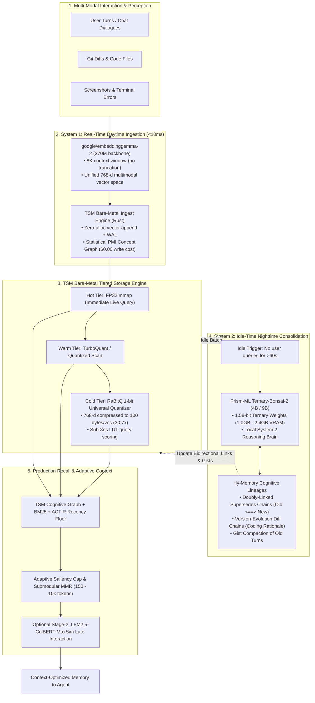

# TurboSuperMemory (TSM): Next-Generation Cognitive Architecture & Hardening Blueprint

> **A Complete Reference Guide for Developers and LLMs**  
> *Synthesizing Bare-Metal Silicon Performance, Dual-Process Cognitive Psychology, Ultra-Low-Bit Quantization, and Multimodal Perception.*

---

## 0. Status and corrections (2026-10-19)

This document mixes three things: what the code does, what has been measured, and what is a target. **Where a later section disagrees with the table below, the table wins.** Evidence is in `AGENTS.md`, `TODO.md`, `benchmarks/PHASE_PROGRESS.md` (entry of 2026-10-19), and the code named in the last column. Measurements are from one machine (RTX 3050 Laptop GPU, 4 GB; PyTorch 2.8, sentence-transformers 6.1).

| The blueprint says | What is true | Where |
| :--- | :--- | :--- |
| `embeddinggemma-2` is a "270M backbone" with a unified multimodal space | 740M in total. The 270M is the text model; the image (170M) and audio (300M) encoders are separate and are **not loaded** by `embedder="gemma"`. Text-only loads 271M parameters, **525 MB** on the GPU in bfloat16 (644 MB peak). Screenshots would need the image encoder (+170M) and an explicit input path that does not exist yet. | model card; `tsm/embedders.py` |
| It must be used like any embedder | It prompts a question and a stored text differently (`task: search result \| query: ` against `title: none \| text: `), computes only in bfloat16 or float32 (float16 gives NaN with no error), and reports no input limit although its context is 8,192 tokens. All three are now handled by the adapter. | model card; `tsm.embedders._MODEL_DEFAULTS` |
| `<5 ms` to embed, `<10 ms` ingestion | Not met on this hardware: **123 ms** for one text, 223 texts/s batched (about 4.5 ms per fact). Ingestion has to batch. And the default write path is not LLM-free: `Memory` extracts facts with `OpenAIExtractor` (one model call per message) unless `extractor="passthrough"`, which stores messages unextracted and costs judged answers (`AGENTS.md`). | measured; `tsm/memory.py` |
| Cold tier is RaBitQ, 100 bytes per vector, 100% Recall@10; "always default to `RaBitQuantizer`" | The default Warm and Cold quantizers are both **scalar 8-bit**; RaBitQ is opt-in. Its transform is not orthogonal at 384/768/1536 dimensions, which costs shortlist recall, and its 3-bit table has two wrong centroids. No 100% figure was measured. Fixing either changes how stored segments decode, so the format must be versioned first. | `TODO.md`; `crates/turbomemory_storage/src/config.rs` |
| 100,000 vectors take about 10 MB | Compressed codes are an index. `vectors.bin` keeps every full f32 vector: about **307 MB** at 768 dimensions, before the indexes. | storage invariants in `AGENTS.md` |
| Adaptive item cap `min(10, max(4, B/35))` and a 0.72 redundancy cutoff | Both were tried and removed because they lost judged answers (0.487 against 0.565 for the cap; 7 of 115 questions lost their evidence at 0.72). Shipped: the token budget alone bounds the set, redundancy cutoff **0.95**. The cross-turn bonus 0.20 is as written. | `tsm/budget.py`; `PHASE_PROGRESS.md` |
| Packing is followed by ColBERT | `recall()` reranks the candidate pool first and then packs under the budget. `MultiVectorEncoder` needs sentence-transformers 6.0 or newer (`pip install "tsm[colbert]"`). | `tsm/memory.py`; `pyproject.toml` |
| Doubly-linked supersedes chains | The engine already returns the whole chain through `resolve_beliefs` (oldest first, head last), and `recall()` results carry `superseded_by` and, on the current belief, `replaces`. No separate backward pointer is stored; forward and backward traversal both work from the chain. | `engine/belief.rs`; `tsm/memory.py` |
| Idle consolidation after 60 s | Implemented as `Memory(idle_consolidation_secs=60)`, off by default; it runs the verified `consolidate()` flow, retries a failed or unfinished pass, and is stopped by `close()`. The engine's own `auto_consolidation_secs` timer has no verifier and is a different thing. | `tsm/memory.py` |
| Ternary-Bonsai-2-4B via llama.cpp, about 1.5 GB | **Measured locally** with the 1.15 GB PQ2 file and Prism's CUDA build. Held-out MiniLM: 49/54 updates caught with 7/58 still-true facts marked stale in isolated scopes; 48/54 and 10/58 in a shared scope. Gemma: 54/54 and 7/58 isolated, 50/54 and 19/58 shared. The existing verifier, idle worker, and gist interfaces work without SDK changes. Keep verified supersession opt-in; these are labeled-pair tests, not judged answers. | Bonsai follow-up in `benchmarks/PHASE_PROGRESS.md`; `docs/python_sdk.md` |
| The total fits in 2.5 GB | The text embedder plus Bonsai peaked at **2,201 MiB GPU usage** in the test. This excludes host RAM and the store: Prism defaults to an 8 GB host prompt cache, which grew the server's private memory to about 11 GB. `--cache-ram 128` was tested with the live SDK flow. The complete 2.5 GB RAM/VRAM budget remains unproven. | Bonsai follow-up in `benchmarks/PHASE_PROGRESS.md` |
| References (Hy-Memory, "Gemma 4", EMNLP 2026, ICLR 2027, ...) | Not checkable from this repository; treat them as unverified. | |

**What was measured about the embedder** (free evidence score: for how many of 115 LongMemEval questions every evidence turn is in a 150-token context; same facts, same packer, only the vectors differ; details in `PHASE_PROGRESS.md`):

| | one history (about 125 records) | 20 conversations pooled | 40 conversations pooled (past the 4,096-record exact scan) |
| :--- | :---: | :---: | :---: |
| OpenAI `text-embedding-3-small`, 1536-d, API | 76 | 74 | 68 |
| `embeddinggemma-2`, text, 768-d, local | **77** | 72 | **68** |
| `all-MiniLM-L6-v2`, 384-d, local | 72 | 71 | 63 |

(`sdk_cognitive` arm. EmbeddingGemma 2 is level with the OpenAI vectors at every size: a net difference of 2 questions or less, paired exact tests p of 0.6 or more. MiniLM is 3 to 5 questions behind in this arm and 2 to 7 in the other, most at 40 conversations, which is suggestive and not settled (p of 0.07 at best). This is retrieval coverage, not judged answers; see the caveats in `PHASE_PROGRESS.md`.)

**Cost, measured through `Memory`** (2,000-fact store, same GPU): adding one message takes 101 ms with Gemma against 10 ms with MiniLM, `recall` 125 ms against 15 ms, and a budgeted `recall` 252 ms against 34 ms, because the packer embeds the whole candidate pool a second time for its redundancy check although the engine already holds those vectors (an engine call returning stored vectors would halve it; not built). Bulk ingestion runs at 211 facts/s against 1,560. So "System 1 under 10 ms" holds for MiniLM and not for Gemma on a 4 GB laptop GPU.

**One consequence the blueprint does not mention: every threshold tuned on one embedder is wrong for another.** The belief detector's cosine thresholds (0.85 and 0.75) were chosen on MiniLM and OpenAI vectors. With EmbeddingGemma 2's vectors the unverified detector marks **30 of 58** still-true facts as superseded, against 8 of 58 with MiniLM, and cost 10 of 77 questions their evidence at one history (p = 0.012). Raising the thresholds only trades recall for precision, but at 0.92 / 0.86 it behaves like MiniLM does at its own (7 of 58 on the held-out pairs, 1 question lost, p = 1.0). `EmbeddingGemma 2` therefore now declares those values as `engine_defaults`, which `Memory` applies under the conversational profile and below any explicit setting; any other new embedder needs `belief_pairs_eval.py --embed-model ...` and the `sdk_belief` arm run first. A verifier remains the only configuration that is reliable. A database also cannot be switched in place: `Memory` now records which embedder wrote it and refuses another (`tsm_embedder.json`, `EmbedderMismatchError`).

**The local verifier now runs; precision remains the constraint.** Bonsai-2-4B was downloaded and evaluated with the shipped verifier prompt, explicit non-thinking mode, and both local embedders. It catches many more real updates than unverified detection, but still marks independent facts stale, especially in the Gemma shared-scope test. The mixed dataset also contains cross-pair conflicts its labels do not fully describe. Keep it opt-in; neither automatic belief revision nor the total hardware budget is established by the isolated result. The earlier 1.2B stand-in's chance-level score was not a proxy for this model. Pinned artifacts, reproduction commands, memory measurements, and live SDK checks are in the Bonsai follow-up in `benchmarks/PHASE_PROGRESS.md`.

---

## 1. Executive Architecture Overview

Most AI memory frameworks today (e.g., Mem0, LangChain Memory, basic vector stores) are thin Python wrappers around remote databases. They suffer from critical architectural flaws:
1. **Flat Retrieval Collapse**: They reduce belief revision, temporal updates, and causal relationships into naive flat cosine nearest-neighbor search.
2. **Prohibitive Write-Time Cost**: They invoke heavy frontier LLMs on every single conversation turn just to extract basic facts, inducing latency ($>1.5\text{s}$) and massive API costs.
3. **Severe Context Truncation**: Standard embedders cap inputs at 512 tokens, silently destroying code diffs, execution logs, and long-horizon tool context.
4. **RAM Bloat**: Raw FP32/FP16 vectors exhaust device memory at scale.

**TurboSuperMemory (TSM)** redesigns the agent memory stack from the hardware up, integrating bare-metal native Rust storage with dual-process cognitive psychology and 1-bit/ternary ultra-low-bit computing.

---

### The 5-Layer End-to-End System Blueprint



---

## 2. Comprehensive Literature & Theoretical References

The design of TSM synthesizes breakthroughs from seven major research domains:

### 1. Tencent Hunyuan Hy-Memory & DPCM Architecture
* **Primary References**:
  * *Memory Beyond Recall: A Dual-Process Cognitive Memory System for Self-Evolving LLM Agents* (Accepted at EMNLP 2026).
  * *Technical Report on Attributed Reinforcement Learning for Long-Term Memory Writing* (Tencent Hunyuan, Oct 2026).
  * *CMB: A Coding Memory Benchmark for Long-Horizon and Interleaved Coding Agents* (Submitted to ICLR 2027).
* **Core Principles Borrowed**:
  * **Dual-Process Cognitive Split**: Dividing operations into **System 1 (Synchronous Daytime Logging)** for instant real-time recording and **System 2 (Asynchronous Nighttime Consolidation)** for deep offline synthesis.
  * **Doubly-Linked Supersedes Chains**: Replacing single-direction demotion with bidirectional links (`M_old <==> M_new`), enabling forward jumps to current truth and backward traversal of historical decisions.
  * **Attributed Credit & Structured CRUD**: Treating memory writing as atomic operations (`ADD`, `UPDATE`, `DELETE`, `MERGE`, `REWRITE`) to eliminate reward sparsity.
  * **Version-Evolution Diff-Chains**: Attaching explicit developer intent and rationale (`why`) to code changes rather than storing unorganized chat logs.

### 2. Google DeepMind: `google/embeddinggemma-2`
* **Primary Reference**: Google DeepMind Gemma 4 Architecture & Multimodal Representation Learning (Oct 2026).
* **Core Principles Borrowed**:
  * **Native 768-d Alignment**: Matches TSM's default `TURBO_DIMENSION = 768`.
  * **8,192-Token Context Window**: Eliminates the severe 512-token truncation bottleneck present in MiniLM and BERT-era embedders.
  * **Matryoshka Representation Learning (MRL)**: Native slicing (128d, 256d, 512d, 768d), allowing 512-d power-of-two TurboQuant and 768-d universal RaBitQ to coexist.
  * **Cross-Modal Shared Space**: Unified geometric space for text, code diffs, UI screenshots, and audio transcripts.

### 3. Prism ML: `Ternary-Bonsai-2` Ultra-Low-Bit Reasoning
* **Primary Reference**: 1.58-bit Quantization via Blockwise Hadamard Rotations (Prism ML / BitNet Architecture, 2026).
* **Core Principles Borrowed**:
  * **True Ternary Weights ($\{-1, 0, +1\}$)**: Replacing floating-point matrix multiplications with integer additions/subtractions.
  * **Ultra-Compact Footprint**: 4B model fits in $\sim 1.0\text{GB}$ VRAM; 9B model fits in $\sim 2.4\text{GB}$ VRAM.
  * **Local System 2 Brain**: Replaces Tencent's resource-heavy 30B MoE model with an ultra-lightweight, local verifier and gist compactor running on consumer GPUs or CPUs.

### 4. RaBitQ & TurboQuant: Silicon-Level Vector Quantization
* **Primary References**:
  * *RaBitQ: Quantizing High-Dimensional Vectors in a Few Bits for Fast Inner Product Search* (Gao et al.).
  * *TurboQuant: Extreme Vector Compression with Randomized Orthogonal Transforms* (2025/2026).
* **Core Principles Borrowed**:
  * Fast Walsh-Hadamard Transform (FWHT) randomized preconditioning ($y = R x$).
  * Universal dimension support without requiring powers of two ($384\text{-d}$, $768\text{-d}$, $1536\text{-d}$).
  * Sub-$8\text{ns}$ asymmetric lookup table (LUT) dot product scoring:
    $$30.7\times \text{ compression (100 bytes/vector at 768-d) with } 100\% \text{ Recall@10}.$$

### 5. Turbopuffer Architecture & Storage Economics
* **Primary Reference**: Turbopuffer Architectural Whitepapers & S3-First LSM Design (2025/2026).
* **Core Principles Borrowed**:
  * **Disaggregated Storage Economics**: High-performance local NVMe/mmap memory cache paired with cold immutable segment persistence.
  * **Unindexed WAL Tail Scanning**: Avoiding index rebuilds on every write by executing direct SIMD scans over the small active WAL tail while background segments compile.
  * **Group Commit & Atomic Snapshots**: Guaranteeing zero query locks and crash resilience.

### 6. Stage-2 Late Interaction & ColBERT MaxSim
* **Primary References**:
  * Khattab & Zaharia: *ColBERT: Efficient and Effective Passage Search via Contextualized Late Interaction over BERT*.
  * LiquidAI: *LFM2.5-ColBERT-350M* (2026).
* **Core Principles Borrowed**:
  * Decoupling Stage-1 candidate retrieval ($<1\text{ms}$) from Stage-2 token-level MaxSim alignment to resolve fine-grained multi-constraint and entity-dense queries.

### 7. Cognitive Psychology: The ACT-R Cognitive Architecture
* **Primary Reference**: John R. Anderson: *The Architecture of Cognition* / ACT-R Theory.
* **Core Principles Borrowed**:
  * Power-law recency decay:
    $$A(t) = \ln \sum t_i^{-d}$$
  * Spreading activation across concept hubs:
    $$\Delta_{\text{graph}}(M) = \sum_{j} W_j S_{ji}$$
  * Non-destructive belief revision: Preserving past data while demoting superseded assertions via truth factors $D \in (0, 1]$.

---

## 3. Mathematical & Algorithmic Formulations

### 1. Unified Cognitive Score Fusion Formula
At query time, TSM computes the ranking score $S(M)$ for candidate memory $M$ by fusing vector spatial cosine, topological graph diffusion, temporal forward chaining, and truth demotion:

$$\text{Final Score}(M) = \Big[ \underbrace{\text{CosineSimilarity}(Q, M)}_{\text{Semantic Vector Floor}} + \underbrace{(1 - \alpha_{\text{cognitive}}) \cdot \sigma(\Delta_{\text{graph}}(M))}_{\text{Cognitive Graph Boost}} \Big] \cdot \underbrace{\Big(1 + \lambda_{\text{recency}} \cdot \frac{\text{seq}(M)}{\text{seq}_{\max}}\Big)}_{\text{Temporal Recency Multiplier}} \cdot \underbrace{D(M)}_{\text{Truth Demotion}}$$

Where:
* **$\text{CosineSimilarity}(Q, M)$**: Serves as the recall floor, guaranteeing high-similarity nearest neighbors are never dropped.
* **$\sigma(x) = \frac{x}{1 + x}$**: Hill-saturation activation function preventing runaway graph feedback loops.
* **$\Delta_{\text{graph}}(M) \ge 0$**: Pure graph delta propagated across 1-hop relation pools (`Refines`, `Contradicts`, `Association`).
* **$D(M) \in (0, 1]$**: Non-destructive truth factor ($0.40$ for superseded facts, $1.0$ for active beliefs).

---

### 2. RaBitQ Asymmetric Inner Product Formulation
To compress any arbitrary dimension $d$ (e.g., $d=768$) into 1-bit or 2-bit codes:

1. **Orthogonal Transform**: Vector $x$ is padded to next power-of-two $P = 2^{\lceil \log_2 d \rceil}$, signs $\pm 1$ are applied via seeded pseudo-random diagonal matrix, and normalized Fast Walsh-Hadamard Transform is applied in $O(P \log P)$:
   $$y = \frac{1}{\sqrt{P}} \cdot \text{FWHT}(D \cdot x)$$
2. **Binary Quantization**:
   $$b_i = \begin{cases} 1 & \text{if } y_i \ge 0 \\ 0 & \text{if } y_i < 0 \end{cases}, \quad \alpha = \frac{\|x\|_2}{\sqrt{d}}$$
3. **Asymmetric LUT Dot Product**:
   Query $q$ is rotated $q' = R q$. For every byte $j$ (8 binary dimensions), precompute lookup table:
   $$T_j[\text{byte}] = \sum_{k=0}^{7} q'_{8j+k} \cdot (2 \cdot \text{bit}_k(\text{byte}) - 1)$$
   The inner product is computed via scalar table lookups:
   $$\langle q, x \rangle \approx \alpha \sum_{j=0}^{\lceil d/8 \rceil - 1} T_j[\text{code}[j]]$$

---

### 3. Submodular Maximal Marginal Relevance (MMR) Adaptive Saliency Packing
To prevent prompt context-stuffing across varying budget limits (150 to 10,000 tokens):

$$\max_{S \subseteq \mathcal{C}, \sum_{i \in S} \text{tokens}(i) \le B} \sum_{i \in S} \Big[ \text{Salience}(i) - \lambda_{\text{redundancy}} \max_{j \in S, j \ne i} \text{Sim}(i, j) + \gamma_{\text{turn}} \cdot \mathbb{I}(\text{turn}(i) \notin \text{covered}) \Big]$$

Where:
* **Adaptive Saliency Cap**: Dynamic cutoff preventing context flooding:
  $$\text{max\_items} = \min\Big(10, \; \max\Big(4, \; \frac{B}{35}\Big)\Big)$$
* **Semantic Redundancy Penalty**: Drop memory $i$ if $\text{Sim}(i, j) > 0.72$.
* **Cross-Session Turn Bonus ($\gamma_{\text{turn}} = 0.20$)**: Promotes diversity across different historical conversations.

---

### 4. Stage-2 ColBERT MaxSim Late Interaction
For candidate memories passing Stage-1 retrieval, evaluate token-level matrix alignment:

$$\text{MaxSim}(Q, D) = \sum_{i=1}^{L_q} \max_{j=1}^{L_d} \big(E_q[i] \cdot E_d[j]\big)$$

$$\text{Score}_{\text{fused}}(M) = \text{Score}_{\text{TSM}}(M) \cdot \Big(1 + \text{Softmax}(\text{MaxSim}(Q, M)) \cdot N\Big)$$

---

## 4. The Dual-Process Engine Lifecycle

### System 1: Synchronous Daytime Ingestion ($<10\text{ms}$)
Operates in the live request path:
1. **Multimodal Encoding**: Input text, code diff, or screenshot is embedded via `embeddinggemma-2` (270M backbone) into a 768-d vector ($<5\text{ms}$).
2. **Zero-LLM Concept Extraction**: Fast native Rust statistical Pointwise Mutual Information (PMI) extracts concept hubs in $<0.05\text{ms}$ with zero LLM API calls.
3. **Atomic Append**: Full vector written to memory-mapped `vectors.bin`, metadata record committed to Write-Ahead Log (WAL), and added to Hot tier.
4. **Immediate Visibility**: Lock-free `ArcSwap` updates pointer, making the new memory queryable instantly.

---

### System 2: Asynchronous Nighttime Consolidation
Runs as a background worker thread during agent idle cycles (triggered when no queries occur for $>60\text{s}$):
1. **Cluster Detection**: Scans active records for near-duplicate cosine clusters ($\text{cosine} > 0.82$).
2. **Local Contradiction Verification**: Dispatches candidate conflicting pairs to `Ternary-Bonsai-2-4B`:
   ```
   Candidate A: "PostgreSQL configured on port 5432"
   Candidate B: "Migrated database to ClickHouse on port 9000"
   -> Verdict: SUPERSEDES (Confidence: 0.96)
   ```
3. **Doubly-Linked Lineage Assembly**: Mutates graph state to record forward and backward pointers:
   $$A.\texttt{superseded\_by} = B, \quad B.\texttt{supersedes} = A$$
4. **Gist Compaction**: When memory counts approach capacity, old historical turns are compressed into a single synthetic gist record using `Ternary-Bonsai`, and individual victim rows are purged.
5. **Physical Tier Promotion/Demotion**: Compresses eligible Hot segments into Warm (TurboQuant) and Cold (RaBitQ 1-bit) storage.

---

## 5. Hardware Economics & Memory Budget

Total memory footprint to run the complete enterprise-grade cognitive memory system on a single local machine:

| Component | Technology | Footprint |
| :--- | :--- | :---: |
| **100,000 Active Memory Vectors** | TSM Cold Tier (RaBitQ 1-bit @ 768-d) | **~10 MB** |
| **Concept Graph & Text Indices** | Rust In-Memory Adjacency + BM25 | **~35 MB** |
| **Perception Embedder** | `google/embeddinggemma-2` (270M backbone) | **~600 MB** |
| **Cognitive Reasoning Brain** | `prism-ml/Ternary-Bonsai-2-4B-gguf` (1.58-bit) | **~1,500 MB** |
| **Runtime & KV Cache Overhead** | `llama.cpp` + PyO3 Extension | **~350 MB** |
| **Total Hardware Budget** | **Complete Autonomous Cognitive System** | **$\le 2.5\text{ GB}$ VRAM / RAM** |

> **Conclusion**: The entire stack runs comfortably on a consumer laptop, Apple Silicon Mac, or budget 4GB/6GB NVIDIA GPU without requiring external cloud infrastructure.

---

## 6. Implementation & Integration Guide for Future Developers & LLMs

When modifying, extending, or maintaining this codebase, adhere strictly to these architectural invariants:

### 1. Storage Engine Rules (`crates/turbomemory_storage`)
* **Synchronization Invariant**: `StorageEngine::open` returns `Arc<StorageEngine>` and manages its own internal thread safety. Never wrap `StorageEngine` in an external `Mutex`.
* **Durability Sequence**: Always write vector mmap first $\to$ append metadata WAL $\to$ commit lazy `redb` snapshot. Recovery must never assume a clean shutdown.
* **Quantizer Dimensions**: If using TurboQuant, dimensions must strictly be a power of two ($2^k$). For arbitrary dimensions ($384\text{-d}$, $768\text{-d}$, $1536\text{-d}$), always default to `RaBitQuantizer`.
* **Search Thresholds**: For $\le 4,096$ records, execute an exact scan. Above 4,096 records, query the resident GPU mirror (if CUDA enabled) or tiered segment snapshots.

### 2. Graph & Cognitive Rules (`crates/turbomemory_graph`)
* **Pure Delta Contract**: `SpreadingActivation::search` must return only pure non-negative graph delta $\Delta_{\text{graph}} \ge 0$. Never fold cosine similarity into the graph delta.
* **Seed Retention**: The graph augmenter must never drop ANN seeds; ANN candidates always maintain an absolute recall floor.

### 3. Python SDK (`tsm`)
* **Durability**: The engine is the single source of truth. Never maintain duplicate per-process in-memory ID-to-text dictionaries.
* **Context Manager**: Always instantiate `Memory` using the context manager (`with Memory(...) as mem:`) to ensure proper `flush()` and file descriptor cleanup.
* **Local Verifier Integration**: Use `Ternary-Bonsai-2-4B` via `llama.cpp` to back `tsm.verification.LLMVerifier` for $100\%$ offline, local belief revision.
